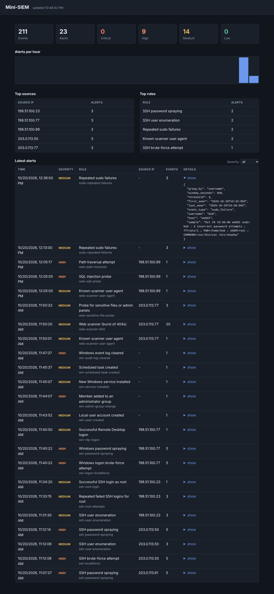
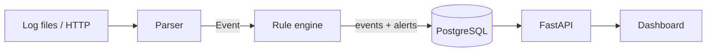

# Mini-SIEM

[](https://github.com/TexAlphaWolf/sec-mini-siem/actions/workflows/ci.yml)
[](LICENSE)




A small, readable SIEM. It parses Linux auth logs (or the systemd journal), web server access logs
and Windows security events, detects attacks with Sigma-style YAML rules, stores everything in
PostgreSQL, and shows alerts in a dashboard.

Built to be understood in an afternoon: about 1,200 lines of Python, no message queue, no
framework magic.

## What it detects

Nineteen rules ship by default, each tagged with its MITRE ATT&CK technique:

| Rule | Severity | Detects |
|------|----------|---------|
| `ssh-bruteforce` | high | 5+ failed SSH logins from one IP in 60 s |
| `ssh-user-enumeration` | medium | 3+ *different* non-existent usernames from one IP in 5 min |
| `ssh-password-spraying` | high | failed logins for 5+ *different* accounts from one IP in 10 min |
| `ssh-root-attempts` | medium | 3+ failed logins for `root` in 5 min |
| `ssh-root-login` | medium | successful direct root login |
| `sudo-repeated-failures` | medium | 3+ failed `sudo` authentications by one user in 10 min |
| `web-scanner-404` | medium | 20+ `404`s from one IP in 60 s (directory brute-forcing) |
| `web-sensitive-file-probe` | medium | repeated requests for `/.env`, `/.git/`, `/wp-login.php`, ... |
| `web-path-traversal` | high | `../`, `/etc/passwd` in a request |
| `web-sqli-probe` | high | `union select` (also with SQL comments), `or 1=1`, `sleep(` in a request |
| `web-scanner-user-agent` | medium | sqlmap, nikto, nmap, ... user agents |
| `win-logon-bruteforce` | high | 5+ failed Windows logons from one IP in 60 s |
| `win-password-spraying` | high | failed Windows logons for 5+ *different* accounts from one IP in 10 min |
| `win-rdp-logon` | medium | successful Remote Desktop logon |
| `win-user-created` | medium | new user account |
| `win-admin-group-change` | high | account added to Administrators, Domain Admins, ... |
| `win-audit-log-cleared` | high | an event log was cleared |
| `win-service-installed` | medium | new Windows service |
| `win-scheduled-task-created` | medium | new scheduled task |

Adding your own takes a few lines of YAML: see [docs/writing-rules.md](docs/writing-rules.md).

```yaml
id: ssh-bruteforce
title: SSH brute-force attempt
severity: high
tags: [attack.credential_access, attack.t1110]
match:
  event_type: [ssh_failed_password, ssh_invalid_user]
threshold:
  count: 5
  window: 60s
  group_by: src_ip
```

## Quick start

You need Docker with Compose.

```bash
git clone https://github.com/TexAlphaWolf/sec-mini-siem.git && cd sec-mini-siem
cp .env.example .env            # then set POSTGRES_PASSWORD in .env
docker compose up -d --build
docker compose exec app minisiem ingest auth /data/auth.log --year 2026
docker compose exec app minisiem ingest nginx /data/access.log
docker compose exec app minisiem ingest journald /data/journal.jsonl
docker compose exec app minisiem ingest windows /data/windows-security.jsonl
```

Open <http://127.0.0.1:8000> (or the port you set in `MINISIEM_PORT`). The sample logs contain a brute-force run, user enumeration, password spraying,
a root login, failed `sudo` attempts, a directory scanner, SQL injection and path traversal probes,
and a Remote Desktop break-in followed by a new administrator account, a service and a task. They
use only [RFC 5737](https://datatracker.ietf.org/doc/html/rfc5737) documentation IP addresses.

### Troubleshooting

- **"ports are not available ... forbidden by its access permissions" (Windows)**: the port is
  in use or reserved by the system. Set another one in `.env` (for example `MINISIEM_PORT=8088`)
  and run `docker compose up -d` again. `netsh interface ipv4 show excludedportrange protocol=tcp`
  lists the ranges Windows has reserved.
- **`POSTGRES_PASSWORD` error**: copy `.env.example` to `.env` and set a password first.

## Run it on your own logs

```bash
# one-off import
docker compose exec app minisiem ingest auth /var/log/auth.log

# keep following a file, like tail -f (mount it into the container first)
minisiem ingest auth /var/log/auth.log --follow

# or push lines from any host over HTTP
curl -X POST --data-binary @/var/log/auth.log \
     -H "Authorization: Bearer $MINISIEM_API_TOKEN" \
     "http://127.0.0.1:8000/ingest/auth?year=2026"
```

Syslog timestamps have no timezone: set `MINISIEM_LOG_TZ` (for example `Europe/Rome`) to match the
machine that wrote the logs. Systemd hosts can send the journal instead
(`journalctl -o json | minisiem ingest journald -`), and Windows events are exported with a short
PowerShell command: see [docs/log-sources.md](docs/log-sources.md).

## Develop without Docker

```bash
python -m venv .venv && source .venv/bin/activate
pip install -e ".[dev]"
pytest --cov                # tests and coverage; SQLite by default,
                            # TEST_DATABASE_URL=postgresql+psycopg://... for PostgreSQL
ruff check .
minisiem rules check        # validate rules
minisiem rules export       # the same rules as Sigma (see docs/writing-rules.md)
minisiem serve              # SQLite file by default; http://127.0.0.1:8000
```

## How it works



1. **Parse**: each line becomes a normalised event (UTC time, IP, user, type, extra fields).
2. **Detect**: rules match on those fields. Threshold rules count events in a sliding window per
   group and alert once per window, so one attack does not create thousands of alerts.
3. **Store and explore**: events and alerts go to SQL; the dashboard reads them through the API.

Details and design decisions: [docs/architecture.md](docs/architecture.md).

## API

| Method | Path | Description |
|--------|------|-------------|
| `GET` | `/` | Dashboard |
| `GET` | `/health` | Liveness and number of loaded rules |
| `POST` | `/ingest/{source}` | Ingest raw lines (`auth`, `nginx`, `journald` or `windows`), body is `text/plain` |
| `GET` | `/api/alerts` | Alerts; filters `severity`, `rule_id`, `limit` |
| `GET` | `/api/events` | Events; filters `source`, `event_type`, `src_ip`, `limit` |
| `GET` | `/api/stats` | Totals, alerts by severity, top sources and rules, hourly timeline |

Interactive docs are at `/docs`.

## Security notes

This is a tool for watching hostile traffic, so it is built to be safe to run near it.

- **Logs are untrusted.** Attackers control usernames, URLs and user agents. The dashboard writes
  everything with `textContent`, never as HTML, and sends a strict Content-Security-Policy. A test
  fails the build if `innerHTML` or similar DOM APIs appear.
- **Local by default.** `docker-compose.yml` binds to `127.0.0.1`. Put a reverse proxy with TLS
  in front before exposing the service.
- **Optional tokens.** `MINISIEM_API_TOKEN` requires a bearer token on `POST /ingest`;
  `MINISIEM_READ_TOKEN` does the same for `GET /api/*`, and the dashboard then asks for it.
- **Bounded input.** Request bodies are capped at 5 MB and read as a stream.
- **No secrets in git.** `.env` is ignored; Compose refuses to start without a database password.
- **Container hardening.** The app runs as a non-root user, with a read-only filesystem, all
  Linux capabilities dropped and `no-new-privileges`.
- **Reporting.** Found a vulnerability? See [SECURITY.md](SECURITY.md).

Only run it against logs from systems you own or are authorised to monitor.

## Limitations

- Run a single worker: detection windows live in memory. After a restart they are rebuilt from
  the stored events, so an attack in progress keeps its count and is not alerted twice.
- Parsers cover `sshd` and `sudo` (auth.log or journald), the nginx/Apache combined format and a
  set of Windows Security and System events (see [docs/log-sources.md](docs/log-sources.md)).
- Retention is off by default: set `MINISIEM_RETENTION_DAYS` or run `minisiem purge --days N`.

## Roadmap

- [ ] Notifications (Telegram, email) when an alert fires
- [ ] GeoIP enrichment of source addresses
- [x] "Distinct values" thresholds (for example 5 different usernames from one IP)
- [x] Windows Event Log and journald parsers
- [x] Persist detection state across restarts
- [x] Export the rules in Sigma format

## Project layout

```
rules/               detection rules (YAML)
sample_logs/         anonymised demo logs
scripts/             sample log generator
src/minisiem/
  parsers/           auth.log, access.log, journald and Windows event parsers
  rules.py           rule loading and the detection engine
  pipeline.py        parse -> detect -> store
  api.py             FastAPI app
  retention.py       delete events and alerts older than N days
  cli.py             minisiem serve | ingest | purge | rules check
  static/            dashboard (HTML, CSS, JS)
tests/               pytest suite
docs/                architecture, rule-writing guide, log sources
```

## License

MIT, see [LICENSE](LICENSE).
