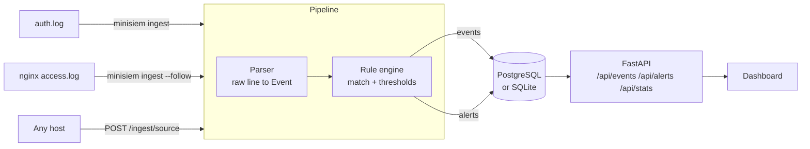

# Architecture

Mini-SIEM is deliberately small: one process, one database, no message queue. Each stage is a
plain module you can read in a few minutes.

## Stages

| Stage | Module | What it does |
|-------|--------|--------------|
| Parse | `parsers/` | Turns a raw line into a normalised `Event` (UTC timestamp, source IP, user, event type, extra fields). Lines it cannot parse are counted as `skipped`, never guessed. |
| Detect | `rules.py` | Loads YAML rules, matches events against them, and applies sliding-window thresholds. |
| Store | `pipeline.py`, `db.py` | Writes events and alerts to SQL in one transaction per batch. |
| Serve | `api.py`, `static/` | JSON API plus a dependency-free dashboard. |

## Design decisions

**Normalise first, then detect.** Rules never see raw text. They match on fields such as
`event_type`, `src_ip` or `status`, so one rule works regardless of how the log was formatted.

**Sigma-inspired rules, not full Sigma.** The rule format borrows Sigma's ideas (field matching,
modifiers, ATT&CK tags) but stays small enough to implement in about 150 lines. Converting to or
from full Sigma is a possible future step.

**Alert once per window.** After a threshold rule fires for a group (for example one IP), that
group is silenced for one window. A sustained attack gives one alert per window instead of one
per log line.

**Time order matters.** The engine evaluates events in timestamp order. A batch is sorted before
it is evaluated.

**Naive UTC everywhere.** Timestamps are converted to UTC on parse and stored without a zone, so
SQLite and PostgreSQL behave the same. The API adds a `Z` suffix.

## Known limitations

- **Detection state is in memory.** Sliding windows reset when the process restarts, so run a
  single worker. A shared store (for example Redis) would be needed to scale out.
- **Batches arriving out of order** across requests can miss a threshold that spans them.
- **One shared token per direction.** `MINISIEM_API_TOKEN` protects `POST /ingest` and
  `MINISIEM_READ_TOKEN` protects `GET /api/*`; there are no users or roles. Bind to localhost
  (the default in `docker-compose.yml`) or put a reverse proxy with TLS in front.
- **Retention is by event time.** With `MINISIEM_RETENTION_DAYS` set, the app deletes older rows
  at startup and then hourly; `minisiem purge --days N` does it once. Importing an old log file
  while a short retention is set deletes it again at the next pass. Retention is off by default.

## Treating logs as hostile input

Attackers control a lot of what ends up in logs: usernames, URLs, user agents. Two rules follow:

1. Parsers validate what they extract (for example, an IP field must be a valid IP or the line is
   dropped).
2. The dashboard writes every value with `textContent`, never `innerHTML`. A test fails the build
   if forbidden DOM APIs appear in `dashboard.js`, and a strict Content-Security-Policy is sent
   with every response.
